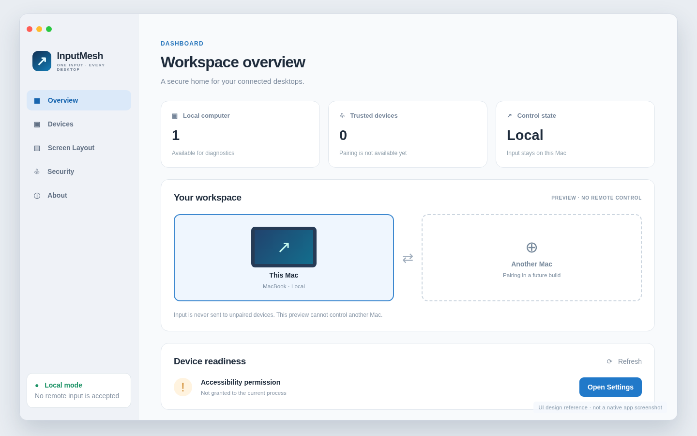

# InputMesh

> **One input. Every desktop.** A future cross-platform, local-first way to use one keyboard and mouse across independent computers.



> **Visual status:** the image is an explicitly labeled **UI design reference** made from an HTML layout. The matching interface is implemented in SwiftUI, but no screenshot of the real macOS app has been validated yet. See [UX specification](docs/ui-ux.md).

## Project status · 20 October 2026

**Developer preview, not Universal Control functionality.** This codebase is under active development; do not install expecting functional cross-Mac control. Native input capture/injection and OS authorization are not yet verified on physical Macs. Security is fail-closed for remote input: no listener or unpaired remote control is exposed by the app.

| Feature | State |
|---|---|
| Shared topology, session model, replay/pressed-state checks | Implemented & unit-tested |
| macOS Quartz passive input probe / injector | Implemented as diagnostic adapters; physical verification pending |
| Native SwiftUI desktop + menu bar / permission onboarding | Implemented; native build/test pending |
| macOS Apple Silicon and Intel native CI + ZIP packaging | Workflow implemented; CI evidence pending |
| Encrypted discovery/pairing, cross-Mac control, clipboard | **Not implemented** |
| Developer ID signature, notarization, reliable 2-Mac handoff | **Not implemented** |
| Windows/Linux support | Adapter contracts only; not implemented |

## Device support & packaging

| Architecture | GitHub Actions build | Minimum declared OS | Release quality |
|---|---|---|---|
| Apple Silicon (M1, M2, M3, M4 and later) `arm64` | `macos-15` | macOS 13 | Unnotarized preview, pending CI |
| Intel x86-64 `x86_64` | `macos-15-intel` | macOS 13 | Unnotarized preview, pending CI |

> The minimum macOS 13 deployment declaration is **not yet a runtime certification**. Actual macOS 13/14/15/26 compatibility needs testing. A production version will only ship after Developer ID signing, notarization and hands-on reliability/security testing.

## Building and trying the local diagnostic preview

Requires a Mac with Xcode CLI tools / Swift 6.2. On a Linux workstation only the platform-neutral core can build.

```bash
git clone https://github.com/truongbo17/inputmesh.git
cd inputmesh
swift test --parallel
./scripts/build-macos-app.sh
open dist/InputMesh.app
```

Only grant permissions after reviewing the app's permissions explanation. This preview operates locally, exposes no network control endpoint and cannot yet connect another Mac. Its `inputmesh --probe` CLI reports counts, not typed keys or pointer coordinates.

Alternatively see [Releases](https://github.com/truongbo17/inputmesh/releases) for clearly marked developer previews, or [Actions](https://github.com/truongbo17/inputmesh/actions) for test reports and CI artifacts. The ZIP is ad-hoc signed, **not** Gatekeeper-notarized; it is not a user-facing stable installer.

## App navigation

- **Overview** — local machine readiness, honest control state and a workspace placeholder.
- **Devices** — pairing status; disabled until encrypted trusted pairing is implemented.
- **Screen Layout** — topology planning (editor pending).
- **Security** — Accessibility status and privacy guarantees.
- **About** — source and preview status.

## Architecture

```text
Sources/
  InputMeshCore/         # Pure Swift algorithms, typed protocol models, release gate
  InputMeshPlatform/     # Cross-platform capture/inject/display/permission interfaces
  InputMeshMacOS/        # AppKit/Quartz display, capture diagnostic, input injector
  InputMeshCLI/          # Non-networked diagnostics
  InputMeshDesktop/      # Native SwiftUI desktop + macOS menu bar
Tests/
  InputMeshCoreTests/    # Linux and macOS portable tests
  InputMeshPlatformTests/
scripts/
  build-macos-app.sh     # Native arch build, .app, ad-hoc signature, ZIP, checksum
  verify-macos-app.sh    # Bundle/arch/signature verification (NOT notarization)
docs/
  ui-ux.md, architecture.md, security.md, cross-platform.md
  competitor-review.md, releasing.md, test-plan.md, roadmap.md
```

The Swift portable core and native adapters are real code; a Go control daemon remains a future architectural option, **not** an implemented dependency. No backend, tracking services or OS-level protection bypass are included.

## Security and release policy

No root or SIP bypass. No key-value logging. No unauthenticated remote input. A legitimate release needs cryptographic pairing, exclusive input leases, fail-open recovery and physical hardware evidence. The [release evidence model](Sources/InputMeshCore/ReleaseGate.swift) deliberately fails until every gate is established. A green unit test does not prove Universal Control works.

- [Developer guide](CONTRIBUTING.md)
- [Native UX specification](docs/ui-ux.md)
- [Cross-platform architecture](docs/cross-platform.md)
- [Security threat model](docs/security.md)
- [Competitor research](docs/competitor-review.md)
- [macOS release engineering](docs/releasing.md)
- [Test plan](docs/test-plan.md)
- [Roadmap](docs/roadmap.md)

License, name availability and distribution strategy must be agreed before public commercialization. No license grant is implied by the repository being publicly visible.
